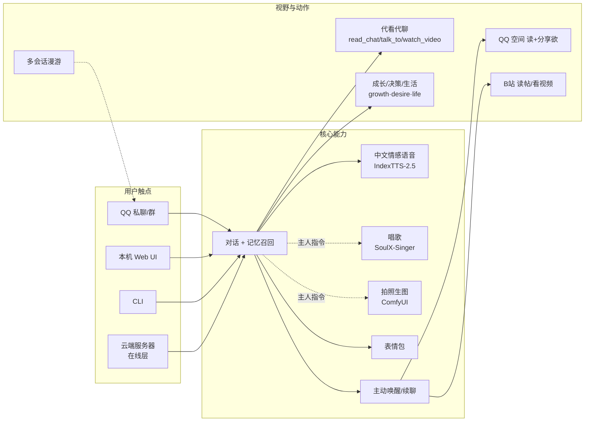
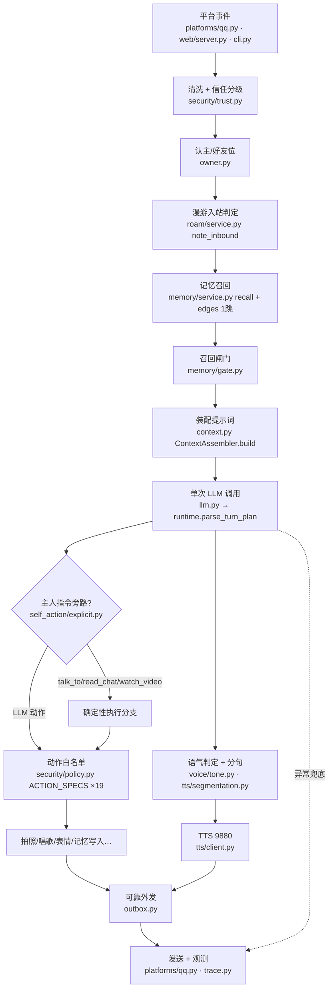
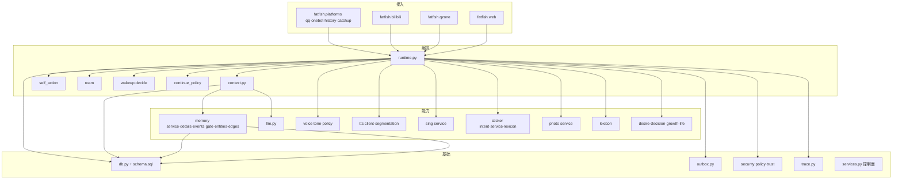

# 项目全景地图

> 上级：[项目总览](project-status.md) · 精简架构：[architecture.md](architecture.md) · 分支详版：[branches/](../branches/) · 决策：[adr/](../adr/)
> 本文是**全景导图**：存放规范、功能图、节点图、代码流程一站式；architecture.md 保持精简速查，分支文档按领域深入。

## 一、存放规范

### 1.1 仓库目录表

| 路径 | 作用 | 是否入库 | 发布树处理 |
|---|---|---|---|
| `fatfish/` | 应用本体（Python 标准库 + SQLite，零第三方依赖） | ✅ | 原样同步 |
| `tests/` | unittest 全量套件（全离线、不联网、不读真实库） | ✅ | 原样同步（研发测试除外） |
| `web/` | 原生前端（无构建） | ✅ | 原样同步 |
| `scripts/` | 服务进程、启动、运维入口 | ✅（白名单） | 30+3 白名单，研发脚本不带 |
| `docs/` | 本文档体系 | ✅ | 精简版白名单 |
| `deploy/` | Linux 部署（systemd 单元、bootstrap） | ✅ | 原样同步 |
| `config/` | profile toml（low/standard/remote/cloud/tts25-live） | ✅ | 同步 + 脱敏（真实端点占位化）；`example.toml` 仅发布树有 |
| `assets/` | 随仓分发资产（复刻参考音频 + 唱歌底稿 json） | ✅ | 仅发布树有（首启由 `install_assets.py` 播种） |
| `staging/` | 本地研发暂存（含 secrets、实验 db） | ⛔ 永不入库 | 不存在 |
| `soulx/` | 唱歌链路研发区（46 文件） | ⛔ | 仅 15 个运行时文件改名 `soulx/` 入发布树 |
| `tasks/`、`skills/`、`scripts/agent_board/` | 多 agent 任务基建 | ✅/本地 | 不入发布树 |
| `data/`、`models/`、`vendor/`、`checkpoints/`、`dist/` | 运行时数据 / 模型权重 / 引擎源码 / 打包产物 | ⛔ git 忽略 | 由 fetch 脚本或用户填充 |
| `.zcode/`、`.workbuddy/`、`.opencode/`、`.agent-board/` | 各 agent 工作区 | ⛔ | 不存在 |
| 根目录研发报告 md、`opencode.jsonc`、`served.html`、`headers.txt` | 一次性产物 | ⛔ 或即弃 | 不存在 |

### 1.2 `data/` 运行时布局与命名

| 路径 | 内容 | 约定 |
|---|---|---|
| `data/fatfish.db` (+`-wal`/`-shm`) | 主库（schema v14，38 表 + FTS 影子表） | 永不入库；结构变更走 `fatfish/schema.sql` + `Database.migrate()` |
| `data/backups/` | 库备份 `fatfish-<用途>-<YYYYMMDD-HHMMSS>.db` | ⛔ 已解跟踪（阶段 3 卫生提交 2026-11-03） |
| `data/run/` | `vram.lock`（显卡租约）、`control.token`（9882 控制口令牌） | 进程退出自动释放锁 |
| `data/soulx/` | 唱歌产物音频、`prompt_v6.json` 唱歌底稿 | 音频 wav 不入库 |
| `data/stickers/` | 表情包库 + `index.json`（本地打标） | 图片本体不入库（发布树走 fetch 脚本） |
| `data/logs/` | 运行日志（napcat-supervisor.jsonl 等） | 台账对比用 |

### 1.3 版本与命名约定

- **schema 三同步**：改 `fatfish/schema.sql` ⇒ `db.py:SCHEMA_VERSION` +1 ⇒ `tests/test_p0.py` 版本断言 ⇒ 旧库幂等升级 + 回填路径。
- **测试基线**：以 `python scripts/test_baseline.py` 实测为准；快照数记在 AGENTS.md（带日期），跨分支变动属正常。
- **ADR 只追加**：决策进 `docs/adr/`，废弃标 `superseded` 不改写；状态只写在 front matter。
- **文档 front matter 五字段**：`title/type/status/tags/updated`；改完 `python scripts/docs_index.py --write`，提交前 `--check`；不新增 `handover-*.md`。
- **提交信息** `type(scope): summary`；任务分支 `task/<名字>`（worktree 推荐 `../fatfish-task-<名字>`）；`main` 经人工 review 后合并。
- **动作协议三同步**：新能力 = `security/policy.py:ACTION_SPECS` → `runtime.py` 执行分支 → outbox handler → Web API → 测试。

### 1.4 本机资源约定（8GB 显卡）

| 端口 | 服务 | 说明 |
|---|---|---|
| 3001 | NapCat WS（QQ 通道） | 纯本机，云端在线层的关键路径 |
| 6099 | NapCat WebUI（扫码） | SSH 隧道或 `napcat_qr_mcp.py` |
| 8765（start_all 默认随机） | 本机 Web | URL 带一次性 token |
| 9880 | IndexTTS-2.5 | `--idle-unload-seconds 0` 永不自动卸载，内存只涨时走 9882 重启 |
| 9881 | bge-base-zh 向量 | embedding |
| 9882 | 服务控制面 | stop/start 服务（token 在 `data/run/control.token`） |
| 8188 | ComfyUI（生图） | 外部进程 |
| 9946 | `photo_server.py`（研发侧） | 云端转发画图请求 |

- TTS / 唱歌 / ComfyUI / 向量**互斥驻留**，共用 `data/run/vram.lock`；重活走 `python scripts/agent_board/gpu.py run --agent <名> --unload-tts --reload-tts -- <命令>`。
- 唱歌结束（含报错/超时）`finally` 里把资源还给 TTS；进程卡死时手动 `POST 9880/load`。
- 渲染、评审、全量测试一律**串行**。

### 1.5 不可入库清单（隐私红线）

1. 真实聊天内容 / QQ 号 / cookie / pskey / token（`.env` 只存环境变量名）。
2. 真实库备份（`data/backups/`）、真实工作日志（`.workbuddy/`）。
3. Tailscale 真实 IP 与 tailnet 主机名（占位：`100.x.y.z`、`<你的主机名>.ts.net`）。
4. 本机路径体系（占位：`D:\fatfish`、`example-tailnet`）。
5. AI 助手工作区（`.zcode/`、`.workbuddy/`、`.agent-board/`）。
6. 敏感值提取与门禁：`scripts/build_release_tree.py --gen-scrub`（值只落 `staging/release-sync/scrub.local.toml`）+ `--gate` 全树复查。

### 1.6 发布树差异速查（独立目录，见同步器 `--dst`）

- **仅发布树有**：`README.md`（对外版）、`AGENTS.md`（AI 部署手册）、`CONTRIBUTING.md`、`LICENSE`、`THIRD_PARTY_NOTICES.md`、`config/example.toml`、`scripts/install_assets.py`、`scripts/fetch_stickers.py`。
- **改名接线**：`soulx/` 15 个运行时文件 → `soulx/`（`fatfish/sing/service.py` 子进程、6 个测试 sys.path 同步改写）。
- **改名测试**：`test_staging_indextts_save.py` → `test_indextts_save.py`。
- **重同步**：`python scripts/build_release_tree.py --plan` 审查 → `--apply` 写入 → `--gate` 复查；发布树内 `git commit --amend` 保持单初始提交。

## 二、功能图



## 三、节点图

### 3.1 单轮对话数据流



### 3.2 进程与端口拓扑

```mermaid
flowchart LR
    subgraph 家里 Windows 主机
        QQAPP[桌面QQ] -.互斥.-> NAPCAT[NapCat 便携版<br>:3001 WS · :6099 WebUI]
        APP[fatfish 应用进程<br>Web :8765/随机 · CLI]
        CTRL[控制面 :9882]
        TTS[IndexTTS-2.5 :9880]
        EMB[bge向量 :9881]
        COMFY[ComfyUI :8188]
        LOCK[data/run/vram.lock]
    end
    subgraph 云端 Linux（ADR-0012 在线层）
        CAPP[fatfish Web + QQ<br>NapCat :3001]
        CCFG[config/cloud.local.toml<br>本机覆盖不入库]
    end
    NAPCAT <-->|OneBot v11| APP
    APP --> CTRL & TTS & EMB
    APP -->|画图/唱歌转发| TUN[tailscale serve]
    TUN --> COMFY & TTS
    CAPP <-->|QQ 收发| NAPCAT
    CAPP -. 30s 探针 .-> TUN
    APP <-->|vram.lock 互斥| TTS & COMFY
```

### 3.3 fatfish 包依赖（分层）



## 四、代码流程详解

### 4.1 单轮主流程（`fatfish/runtime.py`）

| 步骤 | 代码 |
|---|---|
| 入口 | `Runtime.handle_user_message`（QQ/Web/CLI 汇聚点） |
| 漫游前置 | `RoamService.note_inbound`——她漫游在外时，目标房间的开场白 / 主人归位通知优先 |
| 认主 | `try_owner_claim`（owner 绑定、好友位） |
| 召回 | `MemoryService.recall` → `entity_edges` 1 跳关联补充 → `RecallGate.filter` 闸门 |
| 装配 | `ContextAssembler.build`（persona + 日程 + 人际 roster + 记忆 evidence + 注意力块） |
| 旁路判定 | `self_action/explicit.py:explicit_request`——主人原话含"去看看/跟XX说/看这视频"时走确定性分支 |
| LLM | `llm.py` provider 单次调用 → `parse_turn_plan` 解析说话 + 动作 |
| 动作执行 | `security/policy.py` 白名单校验 → 各执行分支；`audit_tool` 落 `tool_audit` |
| 语音 | `voice/tone.py` 判语气 → `_synthesize_reply_segments` 分句 → `tts/client.py` |
| 外发 | `outbox.py`（handler：`qq_send`/`proactive_message`/`friend_share`/`qq_catchup`/`roam_message`/`roam_notice`） |

### 4.2 动作协议（`security/policy.py:ACTION_SPECS`，19 个）

`send_sticker` · `send_voice` · `schedule_wakeup` · `remember` · `open_loop` · `close_loop` · `post_qzone` · `share_with_owner` · `share_to_friend` · `sing` · `search_memory` · `read_qzone` · `read_chat` · `watch_video` · `roam_visit` · `roam_return` · `talk_to` · `make_photo` · `search_videos`

> `talk_to` 虽在白名单，但**只认主人原话指令**（`explicit_request` 确定性旁路），LLM 计划里的同名动作不生效；`read_chat`/`watch_video` 同理带主人指令门槛 + 频控（`watch_video_day` 等计数键）。

### 4.3 记忆子系统（`fatfish/memory/`）

| 件 | 职责 |
|---|---|
| `service.py` | `recall`（多路召回）/ `recall_details`（原子细节）|
| `details.py` | 对话中提取原子细节（谁/何时/偏好） |
| `events.py` | 事件化 episode 素材 |
| `entities.py` + `edges.py` | 人物卡/实体表 + **entity_edges**（同轮共现 → 写边 → 召回时 1 跳关联补证据） |
| `gate.py` | `RecallGate`——召回证据的时点/实体预过滤与上限 |
| `nightly.py`（根） | 夜间做梦：`conversation_turns` → `episodes` / `memory_items` / `rag_chunks` |

### 4.4 语音链路

`voice/tone.py` 语气判定 → `voice/policy.py` 分句策略 → `tts/segmentation.py` 切句 → `tts/client.py:TTSClient.synthesize`（9880，失败缓存已合成句、探针离线时整轮降级纯文字，`runtime.py` 的 `except` 保证「TTS 永不阻塞文字回复」）→ outbox `qq_send` 带 `voice` payload。

### 4.5 唱歌链路

`sing/service.py:SingService.sing` → 资产检查（`missing_assets` 友好降级）→ `_ensure_vram/_wait_for_vram`（抢 `vram.lock`，先卸 TTS）→ 子进程 `soulx/song_v2.py`（15 个运行时件：melody_v2/prosody/legato/humanize/accomp/reverb/transpose_post…）→ `_render_remote`（云端收到请求时经 tailscale 转发回家里 GPU）→ `_finish` 交还资源 → `finalize_song.py` 收句。

### 4.6 平台适配

- **QQ**：`platforms/qq.py` + `onebot.py`（OneBot v11 反代 NapCat:3001）；`platforms/history.py` 群历史/转发/成员读取；图片走 vision 直读（5s 合并窗）。
- **B 站**：`bilibili/client.py`——订阅卡片、视频字幕/快照/相关读取（`watch_video` 的执行体）。
- **QQ 空间**：`qzone/`（feed 读 + 分享欲写 + 浏览器登录态续期，ADR-0011）。

### 4.7 漫游与主动行为（ADR-0013/0014）

`roam/service.py:RoamService`——她可"去"另一个会话串场：`roam_visit`/`roam_return` 动作 + `note_inbound` 入站开场/归位通知；目标必须来自真实 session，群 session 直拒。主动侧：`wakeup/decide.py`（唤醒后先决策 聊天/刷B站/沉默）+ `continue_policy.py` 自续聊节奏（`runtime.py` 的 self-continue 系列方法）。

### 4.8 Web 服务（`fatfish/web/server.py`）

`/api/chat`（流式 `/api/chat/stream`）· `/api/tick` · `/api/nightly` · `/api/people`（人物卡面板）· `/api/lexicon/mine` · `/api/memory/update` · `/api/qzone/*`。共享状态接口串行处理；登录走一次性 token。

### 4.9 数据模型（schema v14，38 表 + FTS 影子）

核心链路：`conversation_turns` → `conversation_events` → nightly 生成 `episodes` / `memory_items` / `rag_chunks` → `RecallGate` 召回；人物侧 `entities` / `entity_edges` / `entity_mentions`；动作侧 `outbox` / `tool_audit` / `decision_log`；另有钱包式状态、sing/photo 任务表等。变更规则见 §1.3。

## 五、与其他文档的关系

| 想看 | 去 |
|---|---|
| 一页速查（分层/12 步表） | [architecture.md](architecture.md) |
| 领域细节（记忆/语音/平台/安全/运维…） | [branches/](../branches/) |
| 为什么这么设计 | [adr/](../adr/) |
| 现状与指标 | [project-status.md](project-status.md) |
| 对外部署（给老师同学/AI 助手） | 发布树 `README.md` + `AGENTS.md` |
